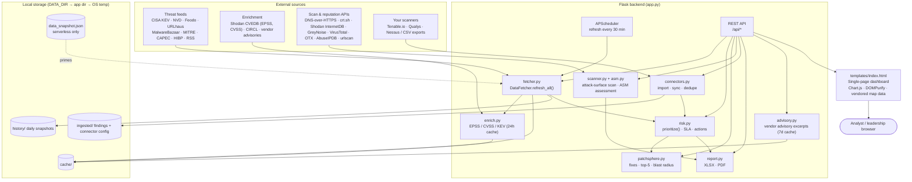

# JATAYU — Threat Intelligence & Exposure Management Dashboard

JATAYU is a self-hosted **Security Operations Center (SOC) dashboard** that
pulls open threat-intelligence feeds, enriches them, correlates them with your
own vulnerability-scan data, and turns the result into a prioritized list of
what to patch first and why.

It is a single Flask application: a Python backend that fetches and scores data
on a schedule, and a single-page dashboard (vanilla JavaScript + Chart.js) that
renders it.

> **Status:** Working application, used for internal demos and QA. Read
> [Security posture and known limitations](#security-posture-and-known-limitations)
> before exposing it to a network.

---

## Table of contents

1. [What JATAYU does](#what-jatayu-does)
2. [Why it helps a cybersecurity organization](#why-it-helps-a-cybersecurity-organization)
3. [Dashboard tour](#dashboard-tour)
4. [How it works](#how-it-works)
5. [Architecture](#architecture)
6. [Data sources](#data-sources)
7. [Technology stack](#technology-stack)
8. [Project layout](#project-layout)
9. [Getting started (local)](#getting-started-local)
10. [Configuration (environment variables)](#configuration-environment-variables)
11. [Deployment](#deployment)
12. [API reference](#api-reference)
13. [Testing and verification](#testing-and-verification)
14. [Operating notes](#operating-notes)
15. [Security posture and known limitations](#security-posture-and-known-limitations)
16. [Documentation index](#documentation-index)
17. [Glossary](#glossary)

---

## What JATAYU does

Security teams face two problems at once: far more vulnerabilities are published
than can be patched, and most of them are never exploited. JATAYU answers the
question *"which of these actually matters to us right now?"*

It does this by combining four kinds of evidence:

| Evidence | Question it answers | Source |
|---|---|---|
| **Exploitation in the wild** | Is this CVE being used by attackers today? | CISA Known Exploited Vulnerabilities (KEV), ransomware association |
| **Exploit probability** | How likely is exploitation in the next 30 days? | EPSS (via Shodan CVEDB) |
| **Severity** | How bad is it if exploited? | CVSS v2 / v3 / v4 (NVD, CVEDB, CIRCL) |
| **Your exposure** | Do *we* have it, and where? | Your scanner exports (Tenable, Qualys, Nessus, CSV) and live attack-surface scans |

On top of that it tracks **indicators of compromise** (malicious IPs, URLs and
malware hashes), **threat actors**, **zero-day research**, **dark-web and breach
chatter**, and **geopolitical** activity, so analysts see the threat landscape
and their own exposure in one place.

---

## Why it helps a cybersecurity organization

| Benefit | What it means in practice |
|---|---|
| **Patch the right things first** | A risk score blends exploitation status, EPSS, CVSS, ransomware association and exposure, so a few hundred KEV-listed CVEs on your network float above thousands of theoretical criticals. |
| **One view instead of ten tabs** | CISA KEV, NVD, abuse.ch, MITRE ATT&CK, zero-day advisories, vendor PSIRT feeds, and breach data are merged into one dashboard and one set of exports. |
| **Less analyst toil** | De-duplication across scanners (the same CVE reported by Tenable and Qualys is reconciled into one fix), plus pre-built remediation text and vendor-advisory excerpts. |
| **Attack-surface visibility outside the scanner** | The scanner looks at a domain or IP from the outside: DNS, TLS, security headers, cookies, exposed admin panels, look-alike domains, subdomains and public reputation. |
| **Choke-point thinking** | PatchSphere estimates which assets, if compromised, would let an attacker reach the most others, so you can fix the highest-leverage hosts first. |
| **Audit-ready output** | Per-section and whole-platform exports in **XLSX** (technical workbook) and **PDF** (executive brief), plus an ASM-style assessment with standards mapping (OWASP, CWE, NIST, ISO-style control references), phase coverage, a remediation roadmap, and SLA timelines. |
| **Trend tracking** | Daily snapshots are archived, so you can see whether exploited CVEs, IOCs and breaches are rising or falling. |
| **Cheap to run** | Built on free public data sources. Paid keys (OTX, VirusTotal, AbuseIPDB, Anthropic) are optional enrichments. |
| **Self-hosted** | Scanner exports and connector credentials stay on infrastructure you control. Only the lookups themselves leave the host. |

**Who uses it**

- **SOC analysts** — triage new KEV entries, look up suspicious IPs/URLs/hashes, read zero-day and research feeds.
- **Vulnerability management / patch teams** — work the prioritized risk list and PatchSphere top-5 fixes, export remediation tasks.
- **Threat intelligence teams** — track actors, geopolitical activity, and dark-web chatter; export briefs.
- **Security leadership** — read the Command Center and the executive PDF, and track trends over time.
- **Assurance / audit** — use exports and the ASM assessment as evidence of prioritization and SLA tracking.

---

## Dashboard tour

The left navigation contains these sections. Each has its own **Back** and
**Export** controls.

| Section | Purpose |
|---|---|
| **Attack Surface Scanner** (`sec-scanner`) | Enter a domain, IP or ASN and get an outside-in assessment: subdomains, DNS and email security (SPF/DKIM/DMARC), TLS, headers, cookies, tech fingerprinting, exposed panels, look-alike domains, reputation, and a risk score. Scan history keeps the last 25 runs. |
| **Threat Command Center** (`sec-overview`) | Headline counts, top exploited CVEs, critical items and charts at a glance. |
| **Top Exploited CVEs** (`sec-exploited`) | CISA KEV entries with EPSS, CVSS, ransomware flag, required action and due date. |
| **CVEs Requiring Immediate Attention** (`sec-critical`) | Critical NVD CVEs with attack vector and enrichment. |
| **Indicators of Compromise** (`sec-iocs`) | Malicious IPs (Feodo Tracker), malicious URLs (URLhaus), malware hashes (MalwareBazaar). Each opens a drawer with detail and lookup links. |
| **Top Threat Actors** (`sec-actors`) | MITRE ATT&CK groups with aliases, techniques and descriptions. |
| **Geo-Political Threat Intelligence** (`sec-geo`) | Country-level view on a world map, built from IOC origin and actor attribution. |
| **Dark Web Intelligence** (`sec-darkweb`) | Breach records (Have I Been Pwned) and forum/news chatter from curated security feeds. |
| **Security Research Intel** (`sec-research`) | Aggregated advisories and write-ups from 30+ vendor, government and research feeds, de-duplicated across sources. Each item can be exported as a Big-4 style PDF brief. |
| **Threat Analytics** (`sec-analytics`) | Trend charts built from archived daily snapshots. |
| **Scanner Connectors** (`sec-connectors`) | Import scanner exports (Nessus, Qualys, CSV) or sync live from Tenable.io and Qualys. Shows ingestion stats. |
| **Risk Prioritization** (`sec-risk`) | Your ingested findings, correlated with KEV, ransomware and EPSS, ranked by risk score with SLA due dates and recommended actions. Filterable and exportable. |
| **PatchSphere** (`sec-patchsphere`) | De-duplicated "fixes", the top-5 to do now, blast-radius analysis for each vulnerability, and choke-point assets on an inferred attack graph. |

A **Custom Report Builder** and per-section export are available from the
dashboard, and an **Ask AI** action on a CVE drawer can produce remediation
guidance when an Anthropic key is configured.

---

## How it works

### 1. Refresh pipeline (`fetcher.py`)

1. **Scheduled refresh.** On start-up and then every **30 minutes**, APScheduler
   runs `DataFetcher.refresh_all()`.
2. **Parallel fetch.** Ten source tasks run in parallel threads (CISA KEV, NVD,
   Feodo, URLhaus, MalwareBazaar, MITRE ATT&CK threat actors, HIBP breaches,
   dark-web RSS, security research RSS, zero-day feeds). Each has a 90-second
   timeout.
3. **Graceful degradation.** If a source fails or times out, the previous good
   result for that source is kept, so a broken feed never blanks a dashboard
   panel.
4. **Enrichment.** Every KEV and critical CVE is enriched through Shodan CVEDB
   (EPSS, CVSS v2/v3/v4, KEV and ransomware flags). CVSS vectors missing from
   CVEDB are filled from CIRCL. Results are cached on disk for about 24 hours,
   fetched with a bounded thread pool.
5. **Mapping.** CWE → CAPEC → ATT&CK technique mapping links CVEs to attacker
   techniques. MITRE and CAPEC data are cached (24 hours and 7 days).
6. **Publish.** The result replaces the in-memory dataset and is written to a
   dated history file, which feeds the trend views.

### 2. Risk scoring (`risk.py`)

Each finding gets a score from 0 to 100:

```
score = min(100,
    CVSS-derived base (up to 35; falls back to severity)
  + CISA KEV "actively exploited"   (+28)
  + ransomware association          (+13)
  + network attack vector           (+7)
  + asset exposure                  (up to 10, 1.25 per affected asset)
  + EPSS exploit probability        (EPSS × 15)
  + exposure-window boost           (up to 8)
)
```

Bands: **CRITICAL** ≥ 75 · **HIGH** ≥ 50 · **MEDIUM** ≥ 30 · **LOW** < 30.

Each finding also receives:

- an **action** (for example *"Patch immediately — actively exploited (CISA KEV)"*),
- an **SLA due date** (CRITICAL 7 days, HIGH 30, MEDIUM 90, LOW 180),
- an **estimated time-to-weaponization**, derived from EPSS and then severity,
- remediation steps built from CISA's required action, the CVE's propose-action
  text, and vendor advisory references.

### 3. Ingestion of your own scan data (`connectors.py`)

- **File import:** Nessus (`.nessus` XML), Qualys (XML and CSV, including the
  `CVE_ID_LIST` field) and generic CSV exports are parsed into one normalized
  finding schema.
- **Live sync:** Tenable.io (export API, chunked, 90-day window by default) and
  Qualys (API) pull findings directly when credentials are configured.
- Findings are de-duplicated on source, asset (or IP), CVE list, plugin name and
  port, and stored in `ingested/`.

### 4. Attack-surface scanning (`scanner.py`, `asm.py`)

Given a domain, IP or ASN, the scanner runs concurrently:

- **Discovery:** DNS records, subdomain enumeration (crt.sh, CertSpotter, Anubis,
  HackerTarget), ASN prefixes (BGP.he.net), RDAP registration data.
- **Email security:** SPF, DKIM and DMARC checks.
- **Host and web checks:** HTTPS redirect, TLS certificate and protocol checks,
  security headers, cookie flags, technology fingerprinting, directory listing,
  common sensitive paths (soft-404 aware), SQL-error and stack-trace signatures,
  and reflected-input and open-redirect probes.
- **Admin panels:** fingerprints well-known admin and login panels that ship with
  default credentials. It **does not attempt logins**.
- **Look-alike domains:** generates typosquat and homoglyph variants of the target
  and checks whether they resolve.
- **Reputation and intelligence:** Shodan InternetDB, GreyNoise, AbuseIPDB,
  VirusTotal, AlienVault OTX, urlscan.io, ipinfo.

`asm.py` converts the raw scan into an assessment:

- **Phase coverage** across ten assessment phases. Phases 1–5 and 10 are covered
  by the current scanner. Phases 6–9 (software composition analysis, SBOM,
  container and Kubernetes, supply-chain) are shown as **not covered** and are
  not claimed.
- **ASM findings** with VULN-IDs, confidence levels, standards mapping, compensating
  controls, patch guidance and validation steps.
- An executive summary and a **remediation roadmap** in four buckets: 24h, 7d,
  30d, 90d.

### 5. PatchSphere (`patchsphere.py`)

- De-duplicates findings across scanners into unique **fixes**.
- Ranks the **top 5** by the risk engine (no scoring is duplicated).
- Computes **blast radius** for a CVE and **choke points**: assets with the
  highest reach.

> The attack graph is **inferred**, not read from a CMDB. Two assets are treated
> as reachable from each other if they share an exploitable CVE, or if they sit
> in the same /24 subnet (a flat-network assumption). The UI labels this as a
> heuristic decision aid, not ground truth.

### 6. Reports and exports (`report.py`)

- **XLSX** workbooks (openpyxl) for risk, findings, remediation and scan results.
- **PDF** executive reports (ReportLab) for scans, and Big-4 style threat-intel
  briefs for research items.
- A **Custom Report Builder** endpoint assembles selected sections.

---

## Architecture



### Module responsibilities

| Module | Responsibility |
|---|---|
| `app.py` | Flask app, routes, security headers, rate limiting, scheduler start-up, serverless detection. |
| `fetcher.py` | Pulls and normalizes all threat-intel sources; runs the refresh pipeline; manages history and caches. |
| `enrich.py` | Per-CVE enrichment from Shodan CVEDB with CIRCL fallback for CVSS vectors. |
| `advisory.py` | Fetches the authoritative vendor advisory for a CVE and extracts remediation text. Best-effort, with a deep link to the vendor portal as a guaranteed fallback. |
| `risk.py` | Risk scoring, banding, SLA, time-to-weaponization, action text, and the prioritized list. |
| `connectors.py` | Parses Nessus, Qualys and CSV files; syncs Tenable.io and Qualys; stores and de-duplicates findings. |
| `patchsphere.py` | Cross-scanner fix de-duplication, top-5 selection, blast radius and choke points. |
| `scanner.py` | Outside-in attack-surface scan for domains, IPs and ASNs. |
| `asm.py` | Converts scan output into an ASM-style assessment, roadmap and standards mapping. |
| `report.py` | XLSX and PDF generation. |
| `templates/index.html` | The entire dashboard UI: layout, styles, charts, drawers, and client-side rendering. Data is escaped before insertion. |
| `static/` | Vendored Chart.js, chartjs-chart-geo, topojson-client and world-map data, a demo sample scan CSV, and the logo. |

---

## Data sources

| Source | Used for | Key needed |
|---|---|---|
| **CISA Known Exploited Vulnerabilities** | "Actively exploited" CVE list, required actions, due dates | No |
| **NVD (NIST)** | Critical CVEs, CVSS, attack vector | No |
| **Shodan CVEDB** | EPSS, CVSS v2/v3/v4, KEV and ransomware flags per CVE | No |
| **CIRCL Vulnerability-Lookup** | CVSS vectors missing from CVEDB | No |
| **Feodo Tracker (abuse.ch)** | Malicious botnet C2 IPs | No |
| **URLhaus (abuse.ch)** | Malicious URLs | `ABUSECH_AUTH_KEY` (skipped without it) |
| **MalwareBazaar (abuse.ch)** | Malware hashes | `ABUSECH_AUTH_KEY` (skipped without it) |
| **MITRE ATT&CK** and **CAPEC** | Threat-actor profiles, technique names, CWE → CAPEC → ATT&CK mapping | No |
| **Have I Been Pwned** | Public breach records | No |
| **Zero Day Initiative** RSS, **zero-day.cz** (scraped) | Zero-day advisories | No |
| **Vendor PSIRT and government feeds** (Cisco, Palo Alto, FortiGuard, Oracle, Tenable, Siemens, Splunk, NetApp, Okta, A10, Lenovo, Silver Peak, CISA, US-CERT, CERT/CC) | Security research intel | No |
| **Security news and research blogs** (The Hacker News, Wired, Threatpost, Security Affairs, Help Net Security, Mandiant, Rapid7, SANS ISC, Project Zero, Schneier, and others) | Research and dark-web-adjacent news | No |
| **Bundled `feed.rss`** | Offline write-ups from a 0-day research feed, so the research view works without network access | No |
| **Tenable.io**, **Qualys** | Your own vulnerability findings (live sync) | Your account credentials |
| **Shodan InternetDB, GreyNoise, AbuseIPDB, VirusTotal, AlienVault OTX** | Scanner reputation and enrichment | Optional (`VT_API_KEY`, `ABUSEIPDB_KEY`, `OTX_API_KEY`; others need no key) |
| **Anthropic API** | "Ask AI" remediation guidance (model `claude-opus-4-5`) | Optional (`ANTHROPIC_API_KEY`) |
| **Conflictly** | Optional dark-web feed via headless browser | Requires Playwright and a browser install; skipped if absent |

Sources are independent. Any single one can fail without stopping the others.

---

## Technology stack

| Layer | Technology |
|---|---|
| Language | Python 3.12 (`.python-version`, Render `PYTHON_VERSION`) |
| Web framework | Flask ≥ 2.3 |
| Production server | Gunicorn (1 worker, 8 threads, 120 s timeout) |
| Scheduling | APScheduler (`BackgroundScheduler`) |
| HTTP and parsing | requests, feedparser (RSS/Atom), BeautifulSoup 4, dnspython, the standard-library `ssl`/`socket` |
| Browser automation (optional) | Playwright |
| Reporting | openpyxl (XLSX), ReportLab (PDF) |
| AI (optional) | Anthropic Python SDK |
| Configuration | python-dotenv |
| Frontend | Single HTML template with vanilla JavaScript, Chart.js, chartjs-chart-geo, topojson-client, DOMPurify 3.1.6, Font Awesome 6.5.0 (all from cdnjs or vendored), Google Fonts |
| Deployment targets | Render (Blueprint), Railway (Procfile), Vercel (serverless with snapshot) |
| Testing | `selftest.py` (offline functional tests), Playwright-based `verify_*.py` scripts |

Install from `requirements.txt`. The Flask app does not need Node.js. `package.json`
lists only `framer-motion`, which belongs to the separate presentation and video
build tooling in `_deckbuild/`.

---

## Project layout

```
Jatayu/
├── app.py                  Flask app, routes, scheduler, security headers
├── fetcher.py              Threat-intel refresh pipeline and source fetchers
├── enrich.py               CVEDB and CIRCL enrichment
├── advisory.py             Vendor advisory fetch and remediation extraction
├── risk.py                 Risk scoring and prioritization
├── connectors.py           Scanner import (Nessus, Qualys, CSV) and live sync (Tenable, Qualys)
├── patchsphere.py          Fix de-duplication, top-5, blast radius, choke points
├── scanner.py              Outside-in attack-surface scanner
├── asm.py                  ASM / VM assessment engine
├── report.py               XLSX and PDF builders
├── templates/
│   ├── index.html          Dashboard UI (single page)
│   └── index.html.bak      Backup copy of the UI, not used at run time
├── static/                 Vendored JS libraries, world map data, logo, sample scan CSV, screenshots
├── feed.rss                Bundled offline research feed
├── data_snapshot.json      Build-time data snapshot for serverless deployment
├── build_snapshot.py       Generates data_snapshot.json
├── selftest.py             Offline functional self-test (exit code gates CI)
├── verify_ui.py            Headless UI check (Playwright)
├── verify_frontend.py      Headless frontend check (Playwright)
├── verify_patchsphere.py   PatchSphere endpoint check
├── test_ai.py              Anthropic remediation smoke test
├── run_screenshots.py      Captures dashboard screenshots
├── requirements.txt        Python dependencies
├── Procfile                Railway / Heroku-style start command
├── render.yaml             Render Blueprint
├── vercel.json             Vercel build and routes
├── DEPLOY.md               Deployment guide (Render, Railway)
├── VERCEL.md               Deployment guide (Vercel, with limitations)
├── Intel.md                Design reference for a target data model (see Documentation index)
├── UIUX.md, design.md      Design-system guidance documents
├── architecture-flow.html  Visual architecture flowchart
├── ASM/                    Methodology notes for the ASM assessment (phases, finding format, patch framework)
├── threat-intel-zeroday/   Companion skill: zero-day and feed refresh to Excel
├── .agents/, .claude/      AI-assistant skills and agent definitions (development tooling)
├── _deckbuild/, _videobuild/  Build tooling for the overview deck and promo videos
├── cache/, history/, ingested/  Runtime data (git-ignored; created on first run)
└── *.mp4, *.pptx           Demo video, promo videos and overview deck
```

---

## Getting started (local)

**Prerequisites:** Python 3.12, pip, and internet access for live feeds. Use a
virtual environment.

```bash
# 1. Create and activate a virtual environment
python -m venv .venv
.venv\Scripts\activate            # Windows PowerShell / cmd
# source .venv/bin/activate       # macOS / Linux

# 2. Install dependencies
pip install -r requirements.txt

# 3. (Optional) Install the browser for the Playwright-based checks and Conflictly
python -m playwright install chromium

# 4. Create your environment file
copy .env.example .env            # Windows
# cp .env.example .env            # macOS / Linux
#    then add your keys, see "Configuration" below

# 5. Run
python app.py
```

Open **http://localhost:5000**.

On first run the app loads the bundled `data_snapshot.json` so the dashboard
shows data immediately. The scheduler then starts a live refresh in the
background, and the data updates when that finishes (usually within a minute or two).

---

## Configuration (environment variables)

Put these in `.env` for local runs or in the host's environment settings in production.
`.env` is git-ignored.

| Variable | Required | Purpose |
|---|---|---|
| `ABUSECH_AUTH_KEY` | Recommended | Free key from auth.abuse.ch. Enables URLhaus and MalwareBazaar. Without it those two feeds are skipped with a log warning. |
| `OTX_API_KEY` | Optional | AlienVault OTX lookups in the scanner. |
| `VT_API_KEY` | Optional | VirusTotal lookups in the scanner. |
| `ABUSEIPDB_KEY` | Optional | AbuseIPDB reputation in the scanner. |
| `ANTHROPIC_API_KEY` | Optional | Enables "Ask AI" remediation guidance. Without it that action returns a clear message. |
| `DATA_DIR` | Optional | Directory for `cache/`, `history/` and `ingested/`. If unset, the app uses its own folder, then the OS temp folder. Set it to a persistent disk in production. |
| `PORT` | Optional | Port for `python app.py` (default `5000`). Gunicorn takes its port from the host. |
| `VERCEL` / `AWS_LAMBDA_FUNCTION_NAME` | Set by the platform | Switches to serverless mode (no scheduler; serves the snapshot). |

`.env.example` lists only `ABUSECH_AUTH_KEY` and `OTX_API_KEY`. The other
variables above are read from the environment directly.

---

## Deployment

The app needs a **long-running process**, because it runs a background scheduler,
keeps in-memory caches, and performs scans that take 30–60 seconds.

| Option | Fit | Notes |
|---|---|---|
| **Render** (recommended) | Full functionality | `render.yaml` Blueprint. Health check `/api/status`. Free instances sleep when idle, so the first request after a sleep cold-starts. |
| **Railway** | Full functionality | `Procfile` is detected automatically. Generate a domain under *Settings → Networking*. |
| **Vercel** | Limited | Serves the bundled snapshot. Data is only as fresh as the last build, and domain scans time out on the Hobby plan. See `VERCEL.md`. |

**Gunicorn start command** (used by Render and Railway):

```bash
gunicorn app:app --workers 1 --threads 8 --timeout 120 --bind 0.0.0.0:$PORT
```

Why these settings:

- **`--workers 1`** keeps one copy of the scheduler and caches. Multiple workers would each run their own refresh.
- **`--threads 8`** serves concurrent requests.
- **`--timeout 120`** covers long domain scans.

**Persistence.** Restarting the service re-fetches data, which is fine for demos.
For retained history, scan history and ingested findings, attach a disk and set
`DATA_DIR` to its mount path.

**Serverless refresh (Vercel).** Rebuild the snapshot and redeploy to refresh data:

```bash
python build_snapshot.py && vercel --prod
```

---

## API reference

All endpoints return JSON unless noted. Errors use `{"error": "..."}`.

### Dashboard data and status

| Method | Path | Description |
|---|---|---|
| GET | `/` | Dashboard page |
| GET | `/api/status` | Health check (used by Render): last refresh, next refresh, whether data is loaded, archived dates |
| GET | `/api/data` | Full current dataset. Returns 503 while the first live fetch runs and the snapshot is unavailable. |
| POST | `/api/force-refresh` | Starts an immediate refresh |
| GET | `/api/data/<YYYY-MM-DD>` | Archived dataset for one day |
| GET | `/api/trends` | Daily series (exploited, critical, IOCs, breaches, research) for trend charts |

### Scanner

| Method | Path | Description |
|---|---|---|
| GET | `/api/scan?q=<domain\|ip\|asn>` | Run an attack-surface scan. Rate-limited to **5 requests per minute per IP**. Results are cached in memory (16 entries). |
| GET | `/api/scan/history` | List saved scans (last 25) |
| GET | `/api/scan/history/<id>` | Retrieve one saved scan |
| DELETE | `/api/scan/history/<id>` | Delete one saved scan |
| DELETE | `/api/scan/history` | Clear scan history |
| GET | `/api/scan/export/<xlsx\|pdf>` | Export a scan result |

### Remediation and research

| Method | Path | Description |
|---|---|---|
| GET | `/api/remediation?cve=<CVE-ID>` | Remediation guidance for a CVE |
| GET | `/api/remediation/advisory?cve=<CVE-ID>` | Vendor advisory excerpt for a CVE (cached 7 days) |
| GET | `/api/remediation/ai?cve=<CVE-ID>` | AI-generated guidance (needs `ANTHROPIC_API_KEY`) |
| GET | `/api/remediation/export/xlsx` | Remediation workbook |
| GET | `/api/research/report/<id>` | Big-4 style PDF brief for a research item |

### Risk, PatchSphere and findings

| Method | Path | Description |
|---|---|---|
| GET | `/api/risk/prioritized` | Ranked findings with score, band, SLA and action. Filters: text `q`, `priority`, `flag`, `vendor`, `epss_min`. |
| GET | `/api/risk/export/xlsx` | Risk workbook |
| GET | `/api/patchsphere/analyze` | Fixes, top-5, and choke-point graph |
| GET | `/api/patchsphere/blast-radius/<CVE>` | Blast radius for one CVE |
| GET | `/api/findings` | Ingested findings |
| POST | `/api/findings/clear` | Remove ingested findings |
| GET | `/api/findings/export/xlsx` | Findings workbook |

### Connectors

| Method | Path | Description |
|---|---|---|
| POST | `/api/connectors/import` | Upload a Nessus, Qualys or CSV file (max 50 MB) |
| GET / POST | `/api/connectors/config` | Read or set connector configuration |
| POST | `/api/connectors/<tenable\|qualys>/test` | Test credentials |
| POST | `/api/connectors/<tenable\|qualys>/sync` | Sync findings from the vendor |

### Exports and reports

| Method | Path | Description |
|---|---|---|
| GET | `/api/export/<fmt>` | Whole-platform export (`json`, `csv` or `xlsx`) |
| GET | `/api/section/export/<section>/<fmt>` | Export one dashboard section |
| POST | `/api/report/custom` | Custom report from selected sections |

---

## Testing and verification

| Command | What it checks | Needs network? |
|---|---|---|
| `python selftest.py` | Offline functional tests: CSV, Nessus and Tenable parsing, severity normalization, risk counting, stable research IDs, and XLSX and PDF generation. Exit code is non-zero on failure, so it can gate a deploy. | No |
| `python selftest.py -v` | Same, with each check printed | No |
| `python verify_ui.py` | Headless Chromium check that the Analytics charts (including the geo map) render | Launches the app itself; needs Playwright and Chromium |
| `python verify_frontend.py` | Headless render of each section in light and dark themes; saves screenshots to `static/` | Launches the app itself; needs Playwright and Chromium |
| `python verify_patchsphere.py` | PatchSphere renders: top-5 cards, choke-point graph, no JS errors | Launches the app itself; needs Playwright and Chromium |
| `python test_ai.py` | Anthropic remediation call | `ANTHROPIC_API_KEY` |
| `python run_screenshots.py` | Captures screenshots into `static/` | Local server running |

Recommended pre-demo routine:

```bash
python selftest.py
python build_snapshot.py     # refresh the bundled data
python app.py                # then run the verify scripts in another terminal
```

---

## Operating notes

- **Refresh cadence.** The live scheduler runs every 30 minutes. A failed source keeps its last good data.
- **Snapshot.** `data_snapshot.json` is what the app shows at start-up and on serverless. Rebuild it before a demo or a release.
- **Writable paths.** `cache/`, `history/` and `ingested/` resolve through `DATA_DIR`, then the app folder, then the OS temp folder. The app does not crash on a read-only filesystem, but data is lost on restart unless `DATA_DIR` points at persistent storage.
- **Rate limiting.** The scan endpoint allows 5 requests per minute per client IP. The limiter is in memory and per process.
- **Upload cap.** Connector uploads are limited to 50 MB.
- **Response headers.** Responses include `X-Content-Type-Options: nosniff`, `X-Frame-Options: DENY`, a `Referrer-Policy`, a restrictive `Permissions-Policy`, and `Content-Security-Policy: frame-ancestors 'none'`.
- **Export filenames** are sanitized before going into `Content-Disposition`.
- **Scan history IDs** are validated (12 lowercase hex characters) to block path traversal.
- **Dashboard rendering.** All data from feeds and APIs is HTML-escaped before it reaches the DOM. Feed HTML is cleaned with DOMPurify.

---

## Security posture and known limitations

Read this section before deploying.

**1. No built-in authentication or authorization.** Anyone who can reach the
URL can read all dashboard data, run scans and import data. **Put JATAYU behind
SSO, a VPN, or a reverse proxy with authentication**, or restrict it to an
internal network. Do not expose it publicly as-is.

**2. Connector credentials are stored in plaintext.** Tenable and Qualys
credentials are written to `ingested/connectors_config.json`. The file is
git-ignored, but it is not encrypted. Protect the host and its disk accordingly.
Use a dedicated, read-only API user for each scanner.

**3. Active probing.** The attack-surface scanner sends a small number of
crafted **GET** requests to the target. These cover reflected-input, open-redirect
and SQL/stack-trace checks, plus path probes. It makes **no login attempts**.
Scan only assets you own or are authorized to test, and be aware that the target's
logs will record these requests.

**4. Scraped and third-party sources can break.** zero-day.cz is scraped and
Conflictly needs a headless browser. Both are best-effort. Feed structures can
change without notice.

**5. Attack-graph and blast-radius results are heuristic.** They are inferred
from shared CVEs and /24 subnets, not a CMDB. Treat them as a prioritization
aid to validate with your asset data.

**6. Coverage is partial by design.** The scanner does not perform software
composition analysis, SBOM analysis, container or Kubernetes assessment, or
supply-chain review. The ASM assessment states these phases as not covered.

**7. Single-process state.** The scheduler, caches and rate limiter live in one
process. Scale-out needs a shared store and a separate scheduler.

**8. Serverless freshness.** On Vercel, data is only as current as the last
snapshot build, and domain scans can exceed the Hobby timeout.

**9. Hard-coded model name.** The AI remediation endpoint uses `claude-opus-4-5`.
Change it in `app.py` when you move to a newer model.

**10. Vendored and CDN assets.** Chart.js, the map libraries and the world-map data
are vendored. Font Awesome and DOMPurify load from cdnjs, and fonts from Google Fonts.
Some feature icons load from third-party favicon and logo services. In air-gapped
environments, host those assets locally.

---

## Documentation index

| Document | Status | What it covers |
|---|---|---|
| `README.md` (this file) | Current | Overview, architecture, setup, operations |
| `DEPLOY.md` | Current | Render and Railway deployment |
| `VERCEL.md` | Current | Vercel deployment and its limitations |
| `ASM/*.md` | Current | ASM assessment methodology: phases, finding format, patch framework, executive report template |
| `architecture-flow.html` | Current | Visual flowchart of the running system. Its scoring note matches `risk.py`. |
| `Intel.md` | **Design reference, not implemented** | Describes a target architecture with a Node/Express and PostgreSQL data model and a 4-hour refresh. The shipped application is Python/Flask with in-memory and file-based storage, and refreshes every 30 minutes. Use it as background for future design work. |
| `UIUX.md`, `design.md` | Design guidance | Design-system and UI prompt guidance used during the build. Not runtime documentation. |
| `threat-intel-zeroday/SKILL.md` | Companion tool | Standalone zero-day and feed refresh that exports Excel. It describes a 4-hour cycle. |

Where documents disagree with the code, the code is authoritative.

---

## Glossary

| Term | Meaning |
|---|---|
| **ASM** | Attack Surface Management: discovering and assessing internet-facing assets |
| **ATT&CK** | MITRE's catalogue of adversary tactics and techniques |
| **CAPEC** | Common Attack Pattern Enumeration and Classification |
| **CISA KEV** | CISA's Known Exploited Vulnerabilities catalogue: CVEs confirmed exploited in the wild |
| **CVE / CVSS** | Common Vulnerabilities and Exposures identifier / Common Vulnerability Scoring System (severity 0–10) |
| **CWE** | Common Weakness Enumeration: the class of weakness behind a vulnerability |
| **EPSS** | Exploit Prediction Scoring System: probability (0–1) of exploitation in the next 30 days |
| **IOC** | Indicator of Compromise: a malicious IP, domain, URL or file hash |
| **KEV** | See CISA KEV |
| **PSIRT** | Product Security Incident Response Team (vendor security advisory teams) |
| **SBOM** | Software Bill of Materials |
| **SLA (remediation)** | Target time to fix, set by severity: CRITICAL 7 days, HIGH 30, MEDIUM 90, LOW 180 |
| **Choke point** | An asset whose compromise would give an attacker reach to many others (in PatchSphere, inferred) |
| **Blast radius** | The set of assets affected if a given vulnerability is exploited (in PatchSphere, inferred) |
